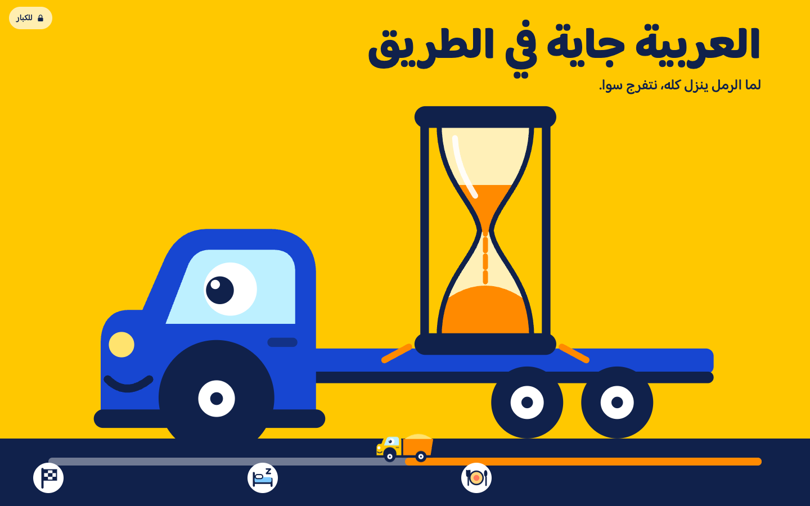
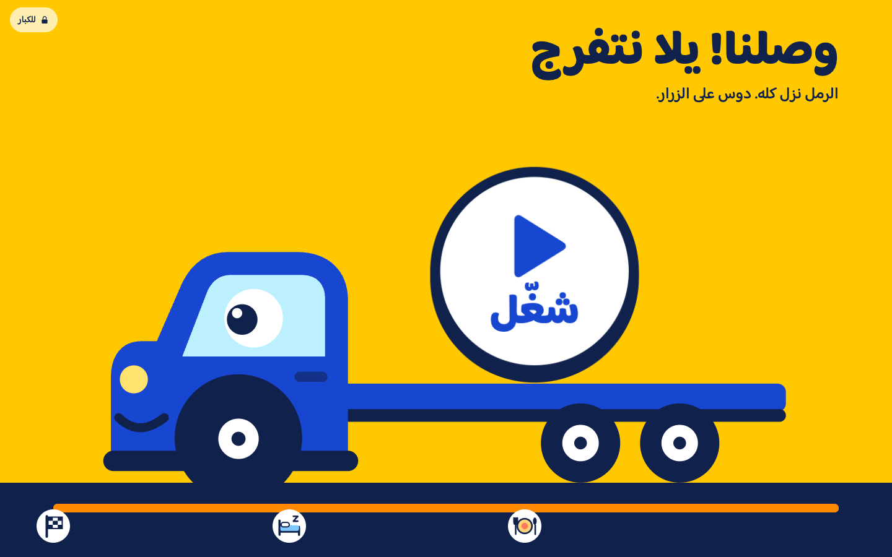
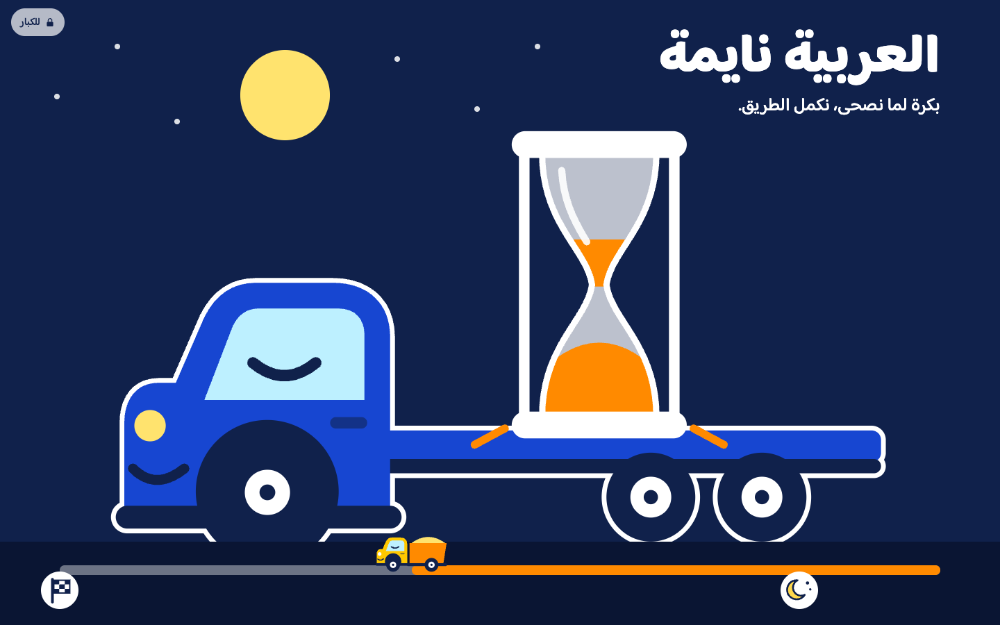

# YouTube Lock for Little Kids

A Chrome extension that gives a young child fixed daily YouTube Kids sessions, and a cheerful waiting page the rest of
the time. A child who cannot read or tell time can see how long is left: the sand runs down while a truck drives past
the stops of the day, such as lunch and nap. Parents keep a password that opens YouTube at any time.



| When it's time | At night |
|---|---|
|  |  |

The interface is in Egyptian Arabic and runs right to left.

## What it does

- **Locked by default.** YouTube pages go to the waiting page, and YouTube embeds on other sites do not load. If Chrome
  crashes or restarts, it stays locked.
- **Two 20-minute sessions a day**, at 10:00 and 17:00 unless you change them. At the set time a big button appears and
  opens YouTube Kids. Full YouTube stays locked.
- **A gentle end.** A small hourglass sits in the corner of YouTube Kids and grows 5 minutes and 1 minute before the end.
- **A password for parents** opens full YouTube for 15, 30 or 60 minutes, or until Chrome closes.
- **Minutes watched today** appear in the extension's panel.
- **Private.** Nothing leaves the browser: no account, analytics or network calls of its own.

## Why these limits

The default of 40 minutes a day sits under the limit for children aged 3 to 4 from the
[World Health Organization](https://www.who.int/news/item/24-04-2019-to-grow-up-healthy-children-need-to-sit-less-and-play-more):
no more than 1 hour, and less is better. The
[Saudi Ministry of Health](https://www.moh.gov.sa/en/healthawareness/educationalcontent/babyhealth/pages/004.aspx)
also gives one hour for preschool children, with an adult. Keep sessions away from meals and from the hour before
bed. These are general guidelines, not medical advice.

Motion is kept slow on purpose: nothing flashes, there is no sound, it stops after a minute, and
`prefers-reduced-motion` is respected. It is a clock, not a game, so there are no rewards or streaks.

## Install

The extension is not in the Chrome Web Store, so you load it yourself.

1. Download this repository and keep the `extension` folder on your computer's internal disk.
2. Open `chrome://extensions` and turn on **Developer mode**.
3. Choose **Load unpacked** and select the `extension` folder.
4. Choose a password on the page that opens.
5. Under **Details**, turn on **Allow in Incognito**.
6. Use your password to set up `youtubekids.com` once, and check a video plays.

Install it in a Chrome profile just for your child: it also blocks YouTube embeds on other sites, which can get in the
way of your own work. The steps are also in Arabic in [INSTALL-ar.md](INSTALL-ar.md).

## Limits

This suits small children, and it is not a security product.

- It covers one Chrome profile. Other browsers, profiles, tablets and phones are untouched.
- Anyone can turn it off at `chrome://extensions`. For older children, use Family Link or Screen Time.
- A forgotten password means removing and reinstalling the extension.
- A video stops mid-way when a session ends.

## Development

No build step and no dependencies. Tests need Node 22 and, for the end-to-end ones, Chrome on a Mac.

```bash
npm test
```

```bash
node tests/e2e.mjs /tmp/lock-profile /tmp/lock-shots
```

```bash
node tests/states.mjs /tmp/states-profile /tmp/states-shots
```

## Licence

The code is under the [MIT licence](LICENSE). The bundled Baloo Bhaijaan 2 font is under the
[SIL Open Font License](extension/fonts/OFL.txt).

Not affiliated with or endorsed by YouTube or Google. YouTube is a trademark of Google LLC.
